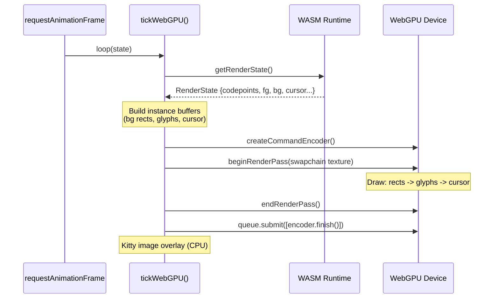
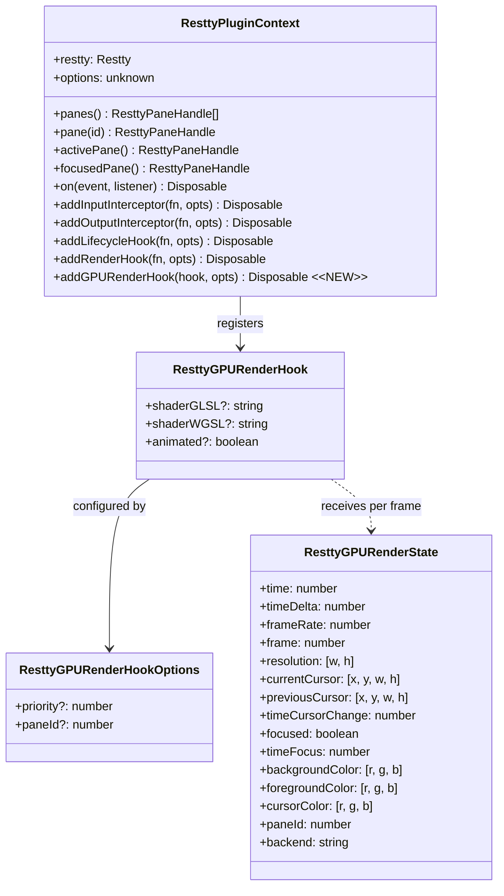
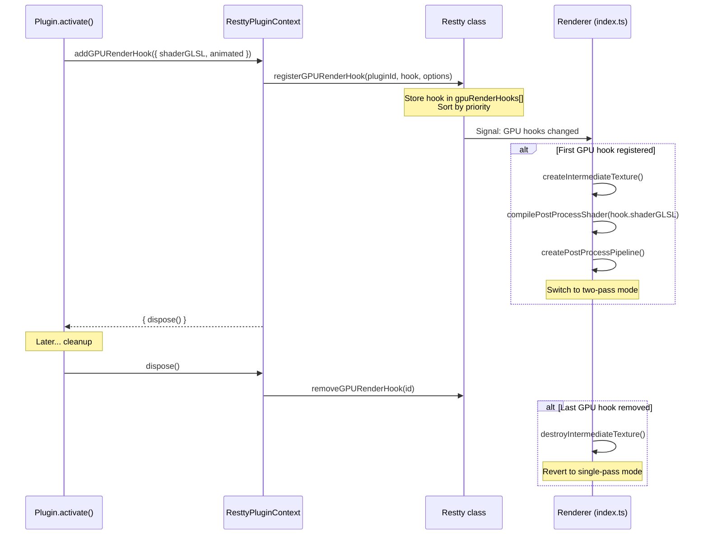

# GPU Render Hooks - Implementation Plan

> **Branch**: `feat/gpu-render-hooks`
> **Fork**: `MKS2508/restty`
> **Upstream**: `wiedymi/restty`

---

## Architecture Overview

### Current Rendering Pipeline (Single Pass)



### Proposed Pipeline (Two Pass - when GPU hooks active)

```mermaid
sequenceDiagram
    participant RAF as requestAnimationFrame
    participant Tick as tickWebGPU()
    participant WASM as WASM Runtime
    participant GPU as WebGPU Device
    participant PP as PostProcess

    RAF->>Tick: loop(state)
    Tick->>WASM: getRenderState()
    WASM-->>Tick: RenderState {cursor, colors...}

    Note over Tick: Track cursor delta<br/>iPreviousCursor, iTimeCursorChange

    Note over Tick: Build instance buffers (unchanged)

    Tick->>GPU: createCommandEncoder()

    rect rgb(40, 60, 40)
        Note over GPU: PASS 1: Terminal -> Intermediate Texture
        Tick->>GPU: beginRenderPass(intermediateTexture)
        Note over GPU: Draw: rects -> glyphs -> cursor
        Tick->>GPU: endRenderPass()
    end

    rect rgb(60, 40, 60)
        Note over PP: PASS 2: Post-Process -> Swapchain
        PP->>GPU: Update Ghostty uniform buffer
        Tick->>GPU: beginRenderPass(swapchain texture)
        Note over GPU: Fullscreen quad + plugin shader<br/>iChannel0 = intermediate texture
        Tick->>GPU: endRenderPass()
    end

    Tick->>GPU: queue.submit([encoder.finish()])
```



### Zero-Overhead Toggle

```mermaid
flowchart TD
    A[GPU hooks registered?] -->|No| B[Single-pass to swapchain<br/>ZERO overhead<br/>No intermediate texture allocated]
    A -->|Yes| C[Two-pass mode]
    C --> D[Pass 1: Terminal -> Intermediate Texture]
    C --> E[Pass 2: Post-process -> Swapchain]

    F[Last GPU hook disposed?] -->|Yes| G[Destroy intermediate texture<br/>Revert to single-pass]
    F -->|No| H[Keep two-pass mode]

    style B fill:#1a3a1a,stroke:#4a8a4a
    style G fill:#1a3a1a,stroke:#4a8a4a
    style D fill:#3a1a3a,stroke:#8a4a8a
    style E fill:#3a1a3a,stroke:#8a4a8a
```



---

## Plugin System Extension

### Current vs Proposed Plugin Context



### Hook Registration Flow



---

## Ghostty Uniform Buffer Layout

The uniform buffer must match Ghostty's `std140` layout for shader compatibility.

```mermaid
block-beta
    columns 4

    block:scene:4
        iResolution["iResolution (vec3)"] iTime["iTime (f32)"]
        iTimeDelta["iTimeDelta (f32)"] iFrameRate["iFrameRate (f32)"]
        iFrame["iFrame (i32)"] pad1["pad"]
    end

    block:compat:4
        iChannelTime["iChannelTime[4]"] iChannelRes["iChannelResolution[4]"]
        iMouse["iMouse (vec4)"] iDate["iDate (vec4)"]
        iSampleRate["iSampleRate (f32)"] pad2["pad x3"]
    end

    block:cursor:4
        iCurrentCursor["iCurrentCursor (vec4)"] iPreviousCursor["iPreviousCursor (vec4)"]
        iCurrentCursorColor["iCurrentCursorColor (vec4)"] iPreviousCursorColor["iPreviousCursorColor (vec4)"]
        iTimeCursorChange["iTimeCursorChange (f32)"] iTimeFocus["iTimeFocus (f32)"]
        iFocus["iFocus (i32)"] pad3["pad"]
    end

    block:colors:4
        iPalette["iPalette[256] (vec3 x 256)"]
        iBg["iBackgroundColor (vec3)"] iFg["iForegroundColor (vec3)"]
        iCursorClr["iCursorColor (vec3)"] iCursorTxt["iCursorText (vec3)"]
        iSelFg["iSelectionFgColor (vec3)"] iSelBg["iSelectionBgColor (vec3)"]
    end

    style scene fill:#1a3a1a,stroke:#4a8a4a
    style cursor fill:#3a1a3a,stroke:#8a4a8a
    style colors fill:#1a3a3a,stroke:#4a8a8a
    style compat fill:#2a2a2a,stroke:#5a5a5a
```



### Uniform Sourcing Map

```mermaid
flowchart LR
    subgraph JS["JavaScript (trivial)"]
        perf["performance.now()"]
        canvas["canvas.width/height"]
        counter["frame counter"]
        doc["document focus events"]
    end

    subgraph WASM["WASM getRenderState()"]
        cursor["cursor.row, cursor.col"]
        colors["fgBytes, bgBytes"]
    end

    subgraph Track["JS Tracking (per frame)"]
        prev["iPreviousCursor<br/>(diff cursor each frame)"]
        tcc["iTimeCursorChange<br/>(timestamp on cursor move)"]
        tf["iTimeFocus<br/>(timestamp on focus gain)"]
    end

    subgraph Theme["Theme Config"]
        palette["iPalette[256]"]
        bgfg["iBackground/Foreground"]
    end

    perf --> iTime & iTimeDelta & iFrameRate
    canvas --> iResolution
    counter --> iFrame
    doc --> iFocus

    cursor --> iCurrentCursor
    cursor --> prev
    prev --> iPreviousCursor
    prev --> tcc

    doc --> tf

    Theme --> palette
    Theme --> bgfg

    style JS fill:#1a3a1a
    style WASM fill:#3a1a1a
    style Track fill:#3a3a1a
    style Theme fill:#1a1a3a
```



---

## File Modification Map

```mermaid
flowchart TB
    subgraph Types["Phase 1: Types"]
        A1["src/app/restty.ts<br/>+ GPU hook types<br/>+ Plugin context method<br/>+ Disposer kind"]
        A2["src/renderer/types.ts<br/>+ PostProcessState type<br/>(WebGPU + WebGL2)"]
        A3["src/index.ts<br/>+ Export new types"]
    end

    subgraph Shaders["Phase 2: Shaders"]
        B1["src/renderer/post-process-shaders.ts<br/>NEW FILE<br/>+ Fullscreen quad WGSL vertex<br/>+ Ghostty uniform wrapper WGSL<br/>+ Ghostty uniform wrapper GLSL 300 ES"]
    end

    subgraph Infrastructure["Phase 3: Renderer Infrastructure"]
        C1["src/renderer/post-process.ts<br/>NEW FILE<br/>+ createPostProcessState()<br/>+ destroyPostProcessState()<br/>+ resizePostProcessTexture()<br/>+ compilePostProcessShader()<br/>+ updateGhosttyUniforms()"]
    end

    subgraph Integration["Phase 4: Plugin + Render Integration"]
        D1["src/app/restty.ts<br/>+ gpuRenderHooks array<br/>+ addGPURenderHook()<br/>+ GPU hook lifecycle"]
        D2["src/app/index.ts<br/>+ Conditional two-pass in tickWebGPU<br/>+ Conditional FBO in tickWebGL<br/>+ Cursor tracking per frame<br/>+ Focus tracking"]
    end

    Types --> Shaders --> Infrastructure --> Integration

    style A1 fill:#2a4a2a
    style A2 fill:#2a4a2a
    style A3 fill:#2a4a2a
    style B1 fill:#4a2a4a
    style C1 fill:#2a2a4a
    style D1 fill:#4a2a2a
    style D2 fill:#4a2a2a
```



---

## Data Flow: Per-Frame Render with GPU Hooks

```mermaid
flowchart TD
    Start([RAF tick]) --> CheckHooks{GPU hooks<br/>registered?}

    CheckHooks -->|No| SinglePass[Single-pass to swapchain<br/>Original code path unchanged]
    SinglePass --> End([Submit & RAF])

    CheckHooks -->|Yes| GetState[getRenderState() from WASM]
    GetState --> TrackCursor[Track cursor delta]
    TrackCursor --> BuildBatches[Build rect + glyph batches<br/>Same as before]
    BuildBatches --> UpdateUniforms[Populate Ghostty uniform buffer<br/>iTime, iResolution, iCursor...]

    UpdateUniforms --> Pass1[PASS 1: beginRenderPass<br/>target = intermediateTexture]
    Pass1 --> DrawTerminal[Draw: rects -> glyphs -> cursor<br/>Existing pipelines, unchanged]
    DrawTerminal --> EndPass1[endRenderPass]

    EndPass1 --> Pass2[PASS 2: beginRenderPass<br/>target = swapchain]
    Pass2 --> BindPlugin[Set plugin shader pipeline<br/>Bind iChannel0 = intermediateTexture<br/>Bind Ghostty uniforms]
    BindPlugin --> DrawQuad[Draw fullscreen quad<br/>6 vertices, 1 instance]
    DrawQuad --> EndPass2[endRenderPass]

    EndPass2 --> End

    style SinglePass fill:#1a3a1a
    style Pass1 fill:#3a1a3a
    style Pass2 fill:#1a3a3a
    style DrawTerminal fill:#2a2a2a
```

---

## Shader Wrapping Strategy

The user provides `mainImage()`. Restty wraps it for the target backend.

### WebGPU (WGSL)

```
[Fullscreen Quad Vertex Shader]     [User's mainImage() transpiled to WGSL]
         |                                        |
         v                                        v
  +-----------+                         +------------------+
  | vsMain()  |  ->  v_uv  ->         | Ghostty Uniforms  |
  | emit      |                        | struct + bindings |
  | position  |                        |                   |
  | + UV      |                        | fsMain() calls    |
  +-----------+                        | mainImage(...)    |
                                       +------------------+
```

### WebGL2 (GLSL 300 ES)

```glsl
// Restty auto-generates this wrapper around user's mainImage():

#version 300 es
precision highp float;

uniform sampler2D iChannel0;
uniform vec3 iResolution;
uniform float iTime;
uniform float iTimeDelta;
uniform float iFrameRate;
uniform int iFrame;
uniform vec4 iCurrentCursor;
uniform vec4 iPreviousCursor;
uniform float iTimeCursorChange;
uniform float iTimeFocus;
uniform int iFocus;
uniform vec3 iBackgroundColor;
uniform vec3 iForegroundColor;
uniform vec3 iCursorColor;
// ... remaining Ghostty uniforms

in vec2 v_uv;
out vec4 _fragColor;

// ---- USER SHADER CONCATENATED HERE ----
// void mainImage(out vec4 fragColor, in vec2 fragCoord) { ... }
// ---- END USER SHADER ----

void main() {
    mainImage(_fragColor, v_uv * iResolution.xy);
}
```

---

## Key Decisions

| Decision | Choice | Rationale |
|---|---|---|
| **Where to store GPU hook state?** | Per-pane in app closure (`index.ts`) | Hooks can target specific panes; renderer state is per-pane |
| **How to signal hooks changed?** | Callback from Restty class to app | The `Restty` class manages plugins, but renderer runs in `index.ts` closure |
| **Intermediate texture format?** | Same as `state.format` (swapchain format) | Avoids format mismatch, sRGB consistency |
| **GLSL 430 -> 300 ES adaptation?** | Wrapper handles it | `texture()` already works in 300 ES; remove `layout(binding=)` from uniforms |
| **WGSL shader support?** | Dual source (`shaderWGSL` + `shaderGLSL`) | No runtime GLSL->WGSL transpiler exists for the browser |
| **Multiple GPU hooks?** | Last wins (priority ordering) | Composing shader passes requires multi-pass which is out of scope for v1 |
| **Animated shader detection?** | Explicit `animated: boolean` flag | Plugin author knows if their shader uses `iTime`; avoids over-rendering |
| **Cursor pixel position?** | Computed from `cursor.col * cellW`, `cursor.row * cellH` | Same as how the renderer positions the cursor rect |

---

## Risk Mitigation

```mermaid
flowchart LR
    subgraph Risks
        R1[Shader compilation<br/>failure]
        R2[Texture format<br/>mismatch]
        R3[Performance<br/>regression]
        R4[Y-axis flip<br/>WebGPU vs Ghostty]
        R5[Canvas resize<br/>stale texture]
    end

    subgraph Mitigations
        M1[try/catch + graceful<br/>fallback to no-effect]
        M2[Use same state.format<br/>for intermediate texture]
        M3[Zero overhead when<br/>disabled + benchmark]
        M4[Flip v_uv.y in<br/>vertex shader]
        M5[Hook into existing<br/>resizeState logic]
    end

    R1 --> M1
    R2 --> M2
    R3 --> M3
    R4 --> M4
    R5 --> M5

    style R1 fill:#4a1a1a
    style R2 fill:#4a1a1a
    style R3 fill:#4a1a1a
    style R4 fill:#4a1a1a
    style R5 fill:#4a1a1a
    style M1 fill:#1a4a1a
    style M2 fill:#1a4a1a
    style M3 fill:#1a4a1a
    style M4 fill:#1a4a1a
    style M5 fill:#1a4a1a
```



---

## Verification Checklist

- [ ] `npm run build` passes with zero errors
- [ ] No changes to existing test files
- [ ] Single-pass path is IDENTICAL to upstream when no GPU hooks registered
- [ ] CRT shader plugin activates and renders correctly
- [ ] Cursor trail shader renders and animates
- [ ] Disposing all GPU hooks reverts to single-pass
- [ ] Canvas resize recreates intermediate texture
- [ ] Shader compilation error doesn't crash - graceful degradation
- [ ] `prefers-reduced-motion` respected (skip animated effects)
- [ ] WebGL2 fallback path works
- [ ] `pluginInfo()` reports `gpuRenderHooks` count
- [ ] New types exported from `src/index.ts`
